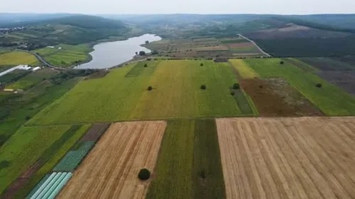
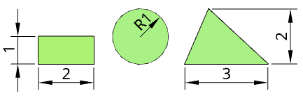
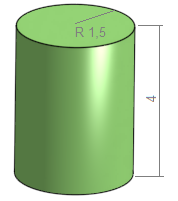
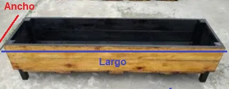
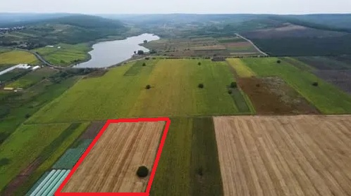
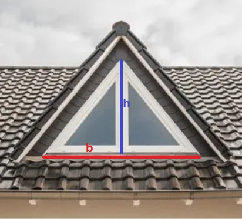
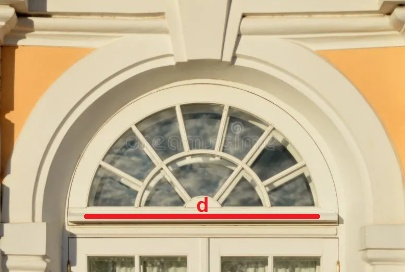

<!-- *** GUIDE START *** -->

::: figure
{width=400px}
:::

La geometría está presente en muchos lugares donde se trabaja y se produce. Los campos como el de la foto tiene parcelas cultivadas generalmente rectangulares. Una huerta tiene canteros, un gallinero tiene paredes y puertas y un tanque puede tener forma cilíndrica.

## 1. Figuras geométricas simples

Las figuras geométricas nos permiten representar y describir la forma de los objetos.

Algunas figuras que encontramos frecuentemente son:

* **Cuadrado:** tiene cuatro lados iguales.
* **Rectángulo:** tiene cuatro lados y sus lados opuestos son iguales.
* **Triángulo:** tiene tres lados.
* **Círculo:** es una figura redonda. La distancia desde el centro hasta el borde se llama **radio**.

::: example

**Ejemplos:**

::: figure


<small>Rectángulo de 2 por 1 cm<br>Circunfierencia de 1 cm de radio<br>Triángulo de 3 cm de base y 1 cm de altura</small>
:::

:::

También podemos encontrar cuerpos geométricos, como:

* **Cilindro:** por ejemplo, un tanque o un tambor.
* **Cubo:** por ejemplo, una caja.
* **Prisma rectangular:** por ejemplo, una caja de herramientas.

::: example

**Ejemplos:**

::: figure


<small>Cilindro de 1,5 cm de radio y 4 cm de altura</small>
:::

:::


### Actividad

::: activity

Dibuja en tu carpeta usando regla y compás cuando sea necesario: 

- un cuadrado de 3 centímetros de lado,
- un rectángulo de 4 por 3 cm,
- un triángulo de 4 cm de base y elige tú la altura,
- un círculo de 2,5 cm de radio,
- un cilindro eligiendo tu las medidas

Debajo de cada dibujo escribí **un objeto del entorno productivo que tenga una forma parecida**. Por ejemplo: Rectángulo → puerta del gallinero.

:::


## 2. Medir cosas del entorno productivo

Para trabajar con medidas necesitamos instrumentos de medición.

Algunos instrumentos que podemos utilizar son:

* **Regla:** para medir objetos pequeños.
* **Cinta métrica:** para medir objetos y distancias mayores.

Las longitudes pueden expresarse en diferentes unidades:

* milímetros (mm)
* centímetros (cm)
* metros (m)

Por ejemplo:

**1 m = 100 cm**

### Actividad

::: activity

**Medir y dibujar:** Elegí **tres elementos del entorno productivo** que puedas medir. Pueden ser: una puerta, una mesa, una ventana, un cajón, un comedero, una parte del gallinero, una herramienta. Para cada elemento:

1. Dibujalo aproximadamente.
2. Indicá sus medidas sobre el dibujo.
3. Escribí qué instrumento utilizaste.

Ejemplo:

```text
        120 cm
   ┌──────────────┐
   │              │
   │              │  80 cm
   │              │
   └──────────────┘

   Cantero de la huerta.
   Se usó cinta métrica.
```

:::


## 3. Perímetro

El **perímetro** es la longitud que hay alrededor de una figura.

Por ejemplo, para un rectángulo:

**Perímetro:**

$P = 2 \cdot (largo + ancho)$

::: example

**Ejemplo**

::: figure

:::

Un cantero rectangular mide **50 cm de ancho** y **2 m de largo**. Antes de calcular se debe poner todas las medidas en la misma unidad. Si elegimos poner todo en centímetros **2 m = 200 cm**.

Su perímetro es:

$P = 2 \cdot (50 + 200) = 500\text{ cm}$

:::

### Actividad

::: activity

**a)** Elegí un espacio rectangular del entorno productivo, por ejemplo un **cantero, corral, sector del gallinero o mesa de trabajo**. Dibujá su forma. Medí el largo y el ancho. Escribí las medidas sobre el dibujo. Calculá su perímetro.

**b)** Para pensar y responder: ¿Por qué puede ser útil conocer el **perímetro** de un corral?

**c)** En la figura de abajo se marcó en rojo un sector de siembra en un campo. Aunque en la imagen aparezca un poco deformado se trata de un sector rectangular que vamos a suponer tiene las siguientes medidas: 1200 metros de largo por 250 metros de ancho. Se quiere poner un boyero que rodeé todo el sector para que no pasen los animales ¿Cuántos metros de alambre hay que comprar? Si se ponen postes cada 8 metros ¿cuántos postes hay que comprar?

::: figure
{width=300px}
:::

**d)** **Desafío no obligatorio:** Suponga que el campo del problema anterior tiene 1,4 km (kilómetros) de largo por 0,35 km de ancho. Además se quiere poner boyero de dos alambres a distinta altura. ¿Cuántos metros de alambre se necesitan? ¿Cuántos postes hay que comprar si se colocan cada 10 metros?  

:::

::: warning
No hay autocorrección en las actividades anteriores.
:::

## 3. Práctica básica de triángulos y círculos

(Hecho en clase)

Teniendo en cuenta las explicaciones de clase hacer las siguientes actividades:

### Actividad

::: activity

#### Triángulos

**a)** Clasificar estos triángulos según sus lados


**b)** Dibujar aproximadamente en la carpeta estos triángulos y señalar la base y la altura de cada uno de ellos


#### Círculos y circunferencias

Recuerda lo que vimos sobre radio y diámetro. También sobre la fórmula para calcular el perímetro de una figura circular, ya sea usando el radio: $P = 2\pi \cdot r$; o el diámetro: $P = \pi \cdot d$.

**a)** Escribir en una frase la diferencia entre círculo y circunferencia

**b)** En este papel medir el radio y el diámetro de cada círculo y marcarlo en el dibujo


**c)** Buscar un objeto cilíndrico, dibujarlo aproximadamente, ponerle las medidas reales de altura y diámetro (o radio), medir con un hilo su perímetro circular y anotarlo.

:::

## 4. Otros ejercicios de perímetro

(Hecho en clase)

Aplica todo lo que aprendiste y resuelve estos ejercicios.

### Actividad

::: activity

**a)** Un granjero hizo un corral rectangular. Largo: 8 m. Ancho: 4 m. El alambrado que usó mide: 🔲 20 m; 🔲 24 m; 🔲 32 m. ¿Qué opción es correcta?

**b)** **Adivinanza:** El corral de las ovejas tiene un perímetro de **30 m**. Sus lados cortos miden **5 m**. ¿Cuánto miden los lados largos?

**c)** Imagina que eres un detective del campo. Encontrar cuál dato es falso, cual huerta tiene error:

- **Huerta A:** Largo: 10 m; Ancho: 6 m; Perímetro: 32 m
- **Huerta B:** Largo: 7 m; Ancho: 3 m; Perímetro: 22 m
- **Huerta C:** Largo: 8 m; Ancho: 4 m; Perímetro: 20 m

**d)** Gana el corral que necesite menos alambrado. ¿Quién gana?

| Corral | Medidas   |
| ------ | --------- |
| A      | 6 m × 5 m |
| B      | 8 m × 3 m |
| C      | 7 m × 4 m |

:::

## 5. Área y perímetro de rectángulos y triángulos

Ya tienes una idea de lo que es el perímetro y de como calcularlo. Ahora vas a recordar especialmente lo que es el área y como calcularla.

### Actividad

::: activity

**a)** Observa este [video](https://www.youtube.com/watch?v=wYNvY_bOGdc) pare repasar perímetro y área. Luego escribe las dos frases de abajo completando con una palabra el espacio vacío: 

*El perímetro es la ______ que rodea una figura. Imagina que quieres poner un hilo alrededor de un jardín: la longitud de ese hilo es el ______. Para calcularlo se ______ todos los lados de la figura. Se mide en unidades de longitud: metros, centímetros, etc.*

*El ______ es la medida de la superficie que ocupa una figura, o sea, cuánto espacio hay dentro de la ______. Piensa en cuántas baldosas caben para cubrir un ______: eso es el área. Para calcular el área de un rectángulo se mutiplica la base "b" por la _____ "h". Se mide en unidades de superficie: metros ______, centímetros cuadrados, etc.*

**b)** Una pantalla de computadora de forma rectangular tiene 40 cm de base (**b**) por 20 cm de altura (**h**). Calcular el área de la misma.

**c)** Dibujar un rectángulo de 8 centímetros cuadrados. Hay varias posibilidades, lo importante es que el área total ($b \cdot h$) sea de $8cm^2$.

**d)** Se hizo una huerta en un terreno rectangular de: Largo: 9 m; Ancho: 4 m. ¿Cuántos metros cuadrados tiene la huerta?

**e)** Dibujar un triángulo de 3 cm de base y 4 cm de altura. Luego calcula su área.

**f)** Una ventana tiene forma triangular donde: Base: 2 m; Altura: 1,5 m. ¿Cuál es el área? Elegir la correcta. 🔲 3 m², 🔲 2 m², 🔲 1,5 m².

::: figure
{width=250px}
:::

**g)** ¿Quién ocupa más espacio?

| Lugar              | Medidas                          |
| ------------------ | -------------------------------- |
| Huerta de tomates  | 6 m × 5 m                        |
| Corral de gallinas | 8 m × 4 m                        |
| Cantero de flores  | Triángulo: base 10 m, altura 4 m |

Ordenar del menor al mayor según el área.

:::

## 6. Área de figuras circulares

Observa este [video](https://www.youtube.com/watch?v=5Ifbq_EQSxUp) y luego realiza las siguientes actividades:

### Actividades

::: activity

En todos los cálculos usa $\pi = 3,14$.

**a)** Juan cortó una cartulina de forma circular. La figura tiene 5 cm de radio. Calcula su perímetro y su área.

**b)** Una tanque australiano usado en el campo para reservar agua tiene una forma circular de 10 m de diámetro. ¿Cuál es su perímetro  y su área?

**c)** La parte superior de una ventana tiene forma de semicírculo, como se muestra en la figura. Si el diámetro es de 2 m que área tiene el vidrio que cubre la ventana. Tener en cuenta que no se trata de un círculo completo.

::: figure
{width=250px}
:::

**d)** **Problema desafío (no obligatorio)**: Un campo tiene un **corral rectangular** de 12 m de largo y 8 m de ancho. Dentro del corral hay un **tanque circular** cuyo diámetro mide 4 m. El resto del corral se quiere cubrir con pasto. ¿Cuántos metros cuadrados de pasto se necesitan?

:::


<!-- *** GUIDE END *** -->


<!-- *** GUIDE AUXILIARY THINGS *** -->

<!--

● Sections: example, activity. solutions, figure, warning, note

::: example
### Ejemplo: Cálculo de derivadas
Aquí va el contenido de tu ejemplo. Puedes usar Markdown normal adentro.
:::


● Image:

::: figure
{width=400px}

<small>Pie (Source)</small>
:::

[⌕](../../images/ ) 

● Videos:

 Change XXX to video-id and put time in seconds

 - Yotube with start point: [Mira este momento clave en el video](https://www.youtube.com/watch?v=XXX&t=123s)

 - Youtubetrimmer with start and end point: [Mirá este momento puntual del video](https://youtubetrimmer.com/view/?v=XXX&start=120&end=150&loop=0)

-->
