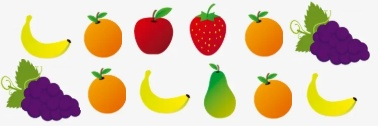

<!-- *** GUIDE START *** -->

::: figure
{width=400px}
:::

## 1. ¿Qué es la estadística?

Es una parte de la matemática que permite recolectar, organizar e interpretar datos para comprender mejor una situación y tomar decisiones.

Ejemplo: 

::: example

Supón que vas a ir de excursión con amigos y tienes que comprar la fruta. Entonces puedes:

- **Recolectar datos:** Preguntar a cada uno que fruta le gusta más.

- **Organizar e interpretar datos:** Hacer una tabla simple y luego comparas los resultados.

| Fruta | Cuantos la eligieron |
|-------|----------------------|
| Manzana | 3 |
| Banana | 2 |
| Naranja | 1 |

- **Tomar decisiones:** Compras la fruta que le gusta a la mayoría: "Manzana".

:::

### Actividades

::: activity

**a)** Mira este [video](https://www.youtube.com/watch?v=SWrLXsR7D14).

**b)** En base al video escribe la siguiente frase poniendo en cada raya la palabra que falta: *La _____ está basada en tres acciones principales: 1) _____, 2) organizar y 3) _____ la información*.

**c)** Escribe las frases de abajo completándolas con las siguientes palabras según corresponda: organizar, datos, son, veces.

- Los datos _____ informaciones que recolectamos.
- Las tablas permiten organizar los _____.
- La frecuencia indica cuántas _____ aparece un dato.
- _____ la información facilita su lectura y comparación.

:::

## 2. Recolección y organización de datos

Aplica lo que aprendiste en el punto anterior resolviendo estos ejercicios de recolección y/o organización de datos.

### Actividades

::: activity

**a)** Se preguntó a 12 chicos que frutas preferían después de hacer deporte. En la figura aparece la fruta que eligió cada uno.

::: figure
{width=400px}
:::

- *a1)* Hacer una tabla poniendo cada fruta:

| Fruta | Cuantos la elegieron |
|-------|----------------------|
|Manzana| 1 |
| ... | ... |

- *a2)* ¿Cuántos alumnos prefieren la pera?
- *a2)* ¿Cuál es la fruta más frecuente?
- *a3)* ¿Cuáles son las dos frutas más elegidas?

**b)** **Encuesta en la familia**

Preguntá a al menos 5 personas de tu familia o conocidos cuales de estos colores prefieren: *rojo, celeste, verde, naranja o amarillo*. Registrá las respuestas y completá una tabla.

| Color | Cantidad que lo eligió |
| -------------------- | ------------------- |
| Rojo                 |                  |
| Celeste              |                  |
| Verde                |                  |
| Naranja              |                  |
| Amarillo             |                  |

- *b1)* ¿Cuál fue el color más elegido?
- *b2)* ¿Qué color o colores aparecen 2 o más veces? 
- *b3)* ¿Cuántas personas participaron?

**c)** **Semillas**

Un alumno contó las semillas de cuatro sobres:

- Sobre A: 12 semillas
- Sobre B: 15 semillas
- Sobre C: 10 semillas
- Sobre D: 13 semillas

Organizá los datos en una tabla y respondé:

- *c1)* ¿Cuántos sobres tienen más de 12 semillas?
- *c2)* ¿Cuál tiene menos?
- *c3)* ¿Cuántas semillas hay en total?

**d)** **Producción de huevos**

Durante una semana se recolectaron:

Lunes: 20 – Martes: 18 – Miércoles: 22 – Jueves: 25 – Viernes: 15.

- *d1)* Construí una tabla.
- *d2)* ¿Qué día hubo mayor producción?
- *d3)* ¿Cuántos días se recolectaron más de 20 huevos?

:::

<!-- *** GUIDE END *** -->

<!-- *** GUIDE AUXILIARY THINGS *** -->

<!--

● Sections: example, activity. solutions, figure, warning, note

::: example
### Ejemplo: Cálculo de derivadas
Aquí va el contenido de tu ejemplo. Puedes usar Markdown normal adentro.
:::

● Image:

::: figure
{width=400px}

<small>Pie (Source)</small>
:::

[⌕](../../images/ ) 

● Videos:

 Change XXX to video-id and put time in seconds

 - Yotube with start point: [Mira este momento clave en el video](https://www.youtube.com/watch?v=XXX&t=123s)

 - Youtubetrimmer with start and end point: [Mirá este momento puntual del video](https://youtubetrimmer.com/view/?v=XXX&start=120&end=150&loop=0)

-->
